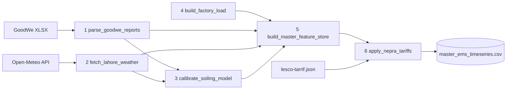

# SolarSense EMS — Developer Guide

For developers who know Python but are new to AI/ML. It explains what the code does, why, and the ML ideas behind it, in the order you'll meet them.

If you hit a term you don't know, look it up in the **[Glossary (§12)](#12-glossary-of-technical-terms)**.

---

## 1. The project in one paragraph

A factory in Lahore has solar panels, a battery, and a grid connection to LESCO, the local utility. Grid power is expensive at peak hours, drawing more than an agreed limit is fined, and dust silently lowers solar output. SolarSense is a **digital twin**: a software model of the plant built from its real data. Later it will advise, and eventually control, three things: when to charge or discharge the battery, when to wash the panels, and whether a panel is damaged.

**Status:**
- **Phase 1, data engineering: done.** All of it is in this repo.
- **Phase 2, AI models and agents: designed, not built.** See [docs/agents.md](docs/agents.md). Its only code so far is the image loader, [src/vision/dataloader.py](src/vision/dataloader.py).

---

## 2. Domain vocabulary (read this first)

| Term | Meaning |
|------|---------|
| **kW vs kWh** | kW = power at an instant (speed). kWh = energy over time (distance). 1 kW for 1 hour = 1 kWh. In hourly data the two numbers are the same. |
| **GHI / DNI / DHI** | Sunlight measurements in W/m². GHI = total on flat ground, DNI = direct beam, DHI = scattered sky light. |
| **POA** | Plane-of-array irradiance: the sunlight landing on the tilted panel. |
| **PR (Performance Ratio)** | Actual energy ÷ theoretical clean energy. A clean system here is about 0.82. A falling PR means dust or a fault. |
| **Soiling / derate** | Dust on the panels, and the % of output it costs. |
| **ToU tariff** | Time-of-Use pricing. **Peak** (18:00–22:00) = 60 PKR/kWh, **off-peak** = 38 PKR/kWh. |
| **MDI / sanctioned demand** | The factory's agreed maximum grid draw (500 kW). Every kW above it in an hour is fined 1,200 PKR. |
| **Peak shaving** | Using the battery to cut grid draw during peaks or spikes. |
| **SoC** | Battery state of charge, in %. |
| **Load shedding** | Scheduled or unscheduled grid outages. Diesel backup then costs 95 PKR/kWh. |

All money constants live in [src/lesco-tarrif.json](src/lesco-tarrif.json).

---

## 3. Repository map

```text
src/
  data_engineering/   Phase 1 pipeline: parse, synthesize, merge, price
  forecast/           Open-Meteo weather (historical download + live forecast client)
  soiling/            Physics model of dust loss + Dataset B audits
  optimizer/          LESCO tariff engine (seasonal peak hours, taxes)
  vision/             Panel-image dataset curation + PyTorch DataLoader
  lesco-tarrif.json   Tariff and penalty constants used by the pipeline
data/processed/
  master_ems_timeseries.csv   THE output: 11,136 hourly rows × 53 columns
docs/                 Dataset audits (dataset_*.md), agent design, sample plots
PROJECT_INSTRUCTIONS.md       Full scope, the 6 datasets, research and safety rules
```

### The six datasets (A–F)

| ID | Content | Status |
|----|---------|--------|
| A | Solar panel photos (clean, dusty, bird droppings, damage) | Curated, 635 images |
| B | Solar generation time series | Real inverter data (GoodWe) |
| C | Factory electrical load | **Synthetic** (generated by rules) |
| D | Grid outages | From inverter logs (22 outage hours) |
| E | Weather | Open-Meteo API |
| F | Tariffs | JSON config |

---

## 4. Phase 1: the data pipeline

### Why this exists
ML models learn from tables. This pipeline turns messy sources (Excel exports, an API, physics rules) into one clean hourly table, the **feature store**. Each column is a **feature**, an input a model can learn from. Each row is one hour.

### The steps



| # | Script | What it does |
|---|--------|--------------|
| 1 | [parse_goodwe_reports.py](src/data_engineering/parse_goodwe_reports.py) | Reads 39 daily inverter Excel reports (5-minute readings) from a `solar 5 minute data/` folder that isn't in git. Also reads a 464-day daily history that is hardcoded in the script. Writes 5-min, hourly and daily solar tables plus an outage log. |
| 2 | [fetch_lahore_weather.py](src/forecast/fetch_lahore_weather.py) | Downloads hourly weather for 2025-07-01 → 2026-10-07 from Open-Meteo (free, no key). |
| 3 | [calibrate_soiling_model.py](src/soiling/calibrate_soiling_model.py) | Estimates daily dust loss (details in §5). |
| 4 | [build_factory_load.py](src/data_engineering/build_factory_load.py) | **Generates** a believable factory load: base load, day/evening shifts, Friday dip, summer AC, plus random noise. |
| 5 | [build_master_feature_store.py](src/data_engineering/build_master_feature_store.py) | Builds an hourly timestamp "spine" and left-joins every table onto it. Daily values are repeated across all 24 hours of their day. |
| 6 | [apply_nepra_tariffs.py](src/data_engineering/apply_nepra_tariffs.py) | Applies prices: tariff window, grid import/export, diesel during outages, MDI penalty, and the wash flag. **Overwrites the master CSV in place.** |

The data moves through layers, a pattern called the **medallion architecture**: raw files ("bronze") → per-source cleaned CSVs ("silver") → the merged master table ("gold").

### Key formulas (step 6)
```text
net_power_kw   = solar_kw - factory_load_kw     (+ export, − import)
grid_import_kw = -net_power_kw if negative and no outage, else 0
cost           = grid_import_kw × tariff_rate_pkr
mdi_penalty    = (grid_import_kw − 500) × 1200   if grid_import_kw > 500
wash flag      = 1 when soiling loss accumulated since the last wash ≥ 15,000 PKR
```

### Master dataset: what the columns mean
| Group | Examples | Granularity |
|-------|----------|-------------|
| Time | `timestamp`, `hour`, `weekday`, `month` | hourly |
| Weather | `ghi_wm2`, `temp_c`, `rain_mm`, `wind_ms` | hourly |
| Solar (high-res) | `solar_energy_kwh`, `battery_soc_mean` | hourly, **only 936 hours (39 days)** |
| Solar (history) | `generation_kwh_daily` | daily, repeated 24× |
| Soiling | `performance_ratio`, `soiling_derate_pct`, `soiling_loss_pkr`, `event_type` | daily, repeated 24× |
| Load / grid | `factory_load_kw`, `grid_import_kw`, `outage_flag` | hourly |
| Money | `electricity_cost_pkr`, `demand_penalty_pkr`, `diesel_backup_cost_pkr` | hourly |
| Decisions | `cumulative_soiling_loss_pkr`, `wash_recommended_flag` | daily |

**Daily columns repeat 24 times per day.** Before summing them, group by date (`df.groupby("date").first()`) or you'll count each day 24×.

---

## 5. The soiling model (physics + simple statistics)

This is the most "scientific" code in the repo, in [calibrate_soiling_model.py](src/soiling/calibrate_soiling_model.py):

1. **Expected clean yield.** From the day's sunlight (GHI) and temperature it computes the energy a *clean* plant should make: `E_clean = GHI × 6.6 kW × 0.82 × temp_derate`. Hot panels lose 0.35% per °C above 25 °C.
2. **Performance Ratio.** `PR = actual ÷ E_clean`. The gap between PR and 0.82 is treated as soiling loss, in kWh and then in PKR.
3. **Fitting the decay curve.** Starting from a confirmed wash on 2026-09-23, it fits `PR(t) = PR_clean × e^(−k·t)` (dust builds up exponentially) using **least squares on log(PR)**. This is linear regression, the simplest ML model.
4. **Detecting past washes with CUSUM.** CUSUM is a change-point detector: it adds up surprises in the day-to-day jumps in generation, and when the running total crosses a threshold it marks a jump. Jumps on rainy days are labelled `rain_wash_detected`; the rest `possible_manual_wash`.

This is classical, explainable modelling. No neural network is involved yet.

---

## 6. ML concepts you'll need for Phase 2

| Concept | One-line explanation | Where it appears here |
|---------|---------------------|----------------------|
| **Feature / label** | Inputs a model sees / the answer it should predict. | Master CSV columns / image class names |
| **Train / val / test split** | Learn on train, tune choices on val, report final score on test once. | Image folders `train/ val/ test/` (70/15/15) |
| **Data leakage** | The same or nearly the same sample in train and test, which makes scores look falsely good. | Why `build_master_dataset.py` removes duplicates (SHA-256 + perceptual hash) *before* splitting |
| **Class imbalance** | Some classes are rare, so a model can just ignore them. | 210 clean vs 64 physical damage; the project rule is every class ≥ 10% |
| **Synthetic data** | Generated, not measured. Models trained on it learn your assumptions. | Factory load (Dataset C) |
| **Time-series forecasting** | Predicting future values from past values + features (hour, weather). | Planned: LightGBM/XGBoost forecasts of load and solar for the next day |
| **Gradient boosting (LightGBM/XGBoost)** | Many small decision trees added together; the strongest default for tabular data. | Planned forecaster |
| **Optimization (MILP)** | Not learning: a solver picks the best battery schedule subject to constraints (capacity, SoC ≥ reserve). | Planned "Peak Shaver" agent |
| **Reinforcement learning (PPO/SAC)** | An agent learns a policy by trial and error in a simulator, rewarded for saving money. | Planned alternative to MILP |
| **CNN** | A neural network for images; learns visual patterns such as dust texture or cracks. | Planned "Vision Inspector" |
| **Transfer learning** | Start from a model pretrained on ImageNet (1M+ photos) and fine-tune it on your 635 images. Essential with small datasets. | Why the loader uses 260×260 and ImageNet normalization |
| **LLM + tool use** | A language model that calls your functions (query the data, run the optimizer) and explains the results in plain language. | Planned "Master Orchestrator" |

### How a forecasting model would use the master CSV (sketch)
```python
X = df[["hour", "weekday", "month", "temp_c", "ghi_wm2"]]   # features
y = df["factory_load_kw"]                                     # label
# Split by TIME, never randomly: train on early months, test on later ones.
# A random split leaks the future into training.
```

---

## 7. Computer vision (Dataset A)

### Curation scripts, run in order
| Script | Role |
|--------|------|
| [download_datasets.py](src/vision/download_datasets.py) | Downloads two Kaggle datasets into `data/raw/panel_images/`. Needs Kaggle credentials in `.env`. |
| [verify_dataset_a.py](src/vision/verify_dataset_a.py) | Audits one dataset: class counts, corrupt files, duplicates, sample grid. |
| [build_master_dataset.py](src/vision/build_master_dataset.py) | **The one that matters.** Converts to RGB, drops snow images (no snow in Lahore), removes exact and perceptual duplicates, caps clean/dusty at 210 each, letterboxes to 512×512, splits 70/15/15, writes `metadata.csv`. |
| [build_hybrid_dataset.py](src/vision/build_hybrid_dataset.py) | An earlier version of the above (SHA-256 only). Superseded. |
| [image_hasher.py](src/vision/image_hasher.py) | **dHash**: a 64-bit fingerprint of an image that changes little when the image is resized or recompressed. Two images whose fingerprints differ in ≤ 2 bits count as duplicates. |
| [deep_inspector.py](src/vision/deep_inspector.py) | Safe RGB conversion, letterbox resize, brightness/contrast stats. |

Output: `data/processed/panel_images/solarsense_master_v1/{train,val,test}/{class}/*.jpg`
Classes: `bird_drop`, `clean`, `dusty`, `electrical_damage`, `physical_damage`.

### The DataLoader ([dataloader.py](src/vision/dataloader.py))
In PyTorch, a **Dataset** returns one `(image_tensor, label)` pair, and a **DataLoader** groups them into shuffled batches. The loader:
- uses `ImageFolder`, which takes each folder name as the label;
- resizes to **260×260** (the native input size of EfficientNet-B2);
- **augments** the train split only, with random horizontal and vertical flips: free extra variety that reduces overfitting. Val and test are never augmented, so scores stay comparable;
- **normalizes** with ImageNet mean/std, because pretrained weights expect inputs on that scale.

```python
from dataloader import build_dataloaders
loaders = build_dataloaders(batch_size=32)
images, labels = next(iter(loaders["train"]))   # [32, 3, 260, 260], [32]
```

---

## 8. Other modules

- [tariff_engine.py](src/optimizer/tariff_engine.py): `LescoTariffEngine`. More detailed than the pipeline: seasonal peak windows (e.g. 19–23 h in summer), taxes and surcharges. It reads `data/processed/tariffs/lesco_tariff_schedule.json`, **which is not in the repo**. The pipeline itself doesn't use it.
- [loss_calculator.py](src/soiling/loss_calculator.py): `SolarPlantLossCalculator`. Real-time "how many kW / PKR am I losing right now" for a plant of any size. It depends on the tariff engine.
- [weather_client.py](src/forecast/weather_client.py): `fetch_lahore_forecast(days)` returns the next few days of weather for live decisions.
- [preprocess_timeseries.py](src/soiling/preprocess_timeseries.py), [verify_dataset_b.py](src/soiling/verify_dataset_b.py): clean and audit external reference datasets (Laghouat soiling study, a Lahore single-panel dataset).

---

## 9. Phase 2 plan, in brief

From [docs/agents.md](docs/agents.md):

```text
          Master Orchestrator (LLM with tool calling)
           /                 |                  \
  Peak Shaver          Maintenance Oracle    Vision Inspector
  (MILP or RL)         (rules + CUSUM)       (CNN on Dataset A)
  battery schedule     wash: yes/no          panel class + alerts
```

Suggested order: Vision Inspector (the data and loader are ready) → load/solar forecaster → battery optimizer → LLM orchestrator.

---

## 10. Setup and running

```bash
pip install -r requirements.txt
```
- Python 3.11+ (3.14 has been used locally).
- `torch`/`torchvision` are pinned to CPU builds; install a CUDA build if you have a GPU.
- `.env` holds Kaggle credentials. Never commit it.
- Run scripts **from the repo root**: some paths are relative to the current folder (`Path("data/...")`).

What you can run on a fresh clone:
| Works | Needs data first |
|-------|-----------------|
| Exploring `master_ems_timeseries.csv` with pandas | Pipeline steps 1–6 (raw files aren't in git) |
| `fetch_lahore_weather.py`, `weather_client.py` (internet) | Vision scripts and the DataLoader (images aren't in git) |
| `build_factory_load.py` | `tariff_engine.py` (missing JSON) |

---

## 11. Known gaps and gotchas

- **Scale mismatch.** The real solar system is small: 6.6 kW of panels and a 5.12 kWh battery. The synthetic factory load averages about 321 kW. So solar barely dents grid import, and the 2.36M PKR of MDI penalties come entirely from the synthetic load spikes. Keep this in mind when you interpret savings.
- **Pandas 3 incompatibility.** `calibrate_soiling_model.py` calls `fillna(method="ffill")`. pandas 3.0 removed that argument, so step 3 crashes with the pinned `pandas==3.0.6`. The fix is `.ffill()`.
- **Two different off-peak rates.** The soiling loss in PKR uses 47.5 PKR/kWh (hardcoded in step 3); the tariff JSON says 38.
- **Missing requirement.** `openpyxl` (needed by step 1) is not in `requirements.txt`.
- **Duplicate tariff file.** `src/lesco tarrif.json` (with a space) looks like a leftover copy; the code reads `src/lesco-tarrif.json`.
- **Wrong README structure.** The README lists `notebooks/` and `tests/`, but neither folder exists, and there are no automated tests.
- **Step 6 edits its own input.** It overwrites the master CSV in place. Re-running it is harmless because it recomputes every column it owns, but keep a copy before you change its logic.

---

## 12. Glossary of technical terms

Plain-language definitions of every technical term this guide uses, grouped by topic. Solar and tariff terms are in [§2](#2-domain-vocabulary-read-this-first).

### Data engineering
| Term | Meaning |
|------|---------|
| **Pipeline** | A chain of scripts where each one's output is the next one's input. |
| **Feature store** | One central table of model-ready inputs that every model reads from, instead of each model re-cleaning raw data. Here, `master_ems_timeseries.csv`. |
| **Feature** | One input column a model uses to make a prediction (e.g. `hour`, `temp_c`). |
| **Label / target** | The column the model is trying to predict (e.g. `factory_load_kw`). |
| **Granularity** | How finely data is sampled: 5-minute, hourly, daily. |
| **Aggregate** | Combine finer data into coarser data, e.g. sum twelve 5-minute readings into one hourly value. |
| **Timestamp spine** | A complete, gap-free list of every hour in the date range. Other tables are joined onto it, so missing hours show up as empty cells instead of missing rows. |
| **Left join** | A merge that keeps every row of the left table (the spine) and fills in matching data from the right table where it exists. |
| **Null / NaN** | An empty value ("not a number"). It is normal here: high-res solar data exists for only 39 of 464 days. |
| **Medallion architecture (bronze/silver/gold)** | A naming convention for data maturity: raw → cleaned per source → merged and ready for business use. |
| **Synthetic data** | Data generated from rules or random numbers rather than measured. Useful for prototyping, but it carries your assumptions. |
| **Telemetry** | Readings a device reports automatically (here, the inverter). |
| **Inverter** | The device that turns the panels' DC power into AC power the factory uses. GoodWe is the brand; SEMS+ is its web portal. |
| **API** | An endpoint that returns data over HTTP. Open-Meteo is a free weather API. |
| **Idempotent** | Running something twice gives the same result as running it once. |
| **SHA-256** | A cryptographic fingerprint of a file's bytes. Identical files have identical hashes, and a single changed byte gives a completely different hash. |
| **Perceptual hash (dHash)** | A fingerprint of what an image *looks like*, not its bytes, so a resized or recompressed copy still matches. |
| **Hamming distance** | The number of bits that differ between two hashes. Here, ≤ 2 counts as a duplicate. |

### Statistics and physics modelling
| Term | Meaning |
|------|---------|
| **Model** | Any function that turns inputs into a prediction. It can be a hand-written formula (physics) or one learned from data (ML). |
| **Baseline** | A reference value to compare against. Here, a clean-panel PR of 0.82. |
| **Calibration** | Tuning a model's constants so its output matches real measurements. |
| **Linear regression** | Fitting a straight line `y = a + b·x` through data points. The simplest ML model. |
| **Least squares** | The standard way to fit that line: choose `a`, `b` so the sum of squared errors is as small as possible. |
| **Exponential decay** | A value that shrinks by a fixed *percentage* per step: `e^(−k·t)`. Taking the log turns it into a straight line, which is why linear regression can fit it. |
| **Decay rate (k)** | How fast the value shrinks. Here, the fraction of output lost to dust each day. |
| **Change-point detection** | Finding the moment a series suddenly shifts level, here a jump in output after a wash. |
| **CUSUM** | Cumulative sum: a running total of how unusual each value is. A sudden shift makes it grow fast and cross a threshold. |
| **z-score** | `(value − mean) / std`: how many standard deviations a value is from average. |
| **Standard deviation (std)** | A measure of how spread out values are. |

### Machine learning (general)
| Term | Meaning |
|------|---------|
| **Training** | Showing a model many examples so it adjusts its internal numbers (**weights / parameters**) to make fewer mistakes. |
| **Inference** | Using a trained model to make predictions on new data. |
| **Train / validation / test set** | Train = what the model learns from. Validation = used to compare settings while developing. Test = held back and used once at the end, for an honest score. |
| **Stratified split** | Splitting so every class keeps the same proportion in train, val and test. |
| **Overfitting** | The model memorizes its training examples instead of learning general patterns, so it scores well on train and badly on new data. |
| **Data leakage** | Information from the test set sneaking into training (e.g. duplicate images in both), giving a misleadingly high score. |
| **Class imbalance** | Some labels have far fewer examples than others; the model may learn to ignore the rare ones. |
| **Hyperparameter** | A setting you choose rather than the model learning it (batch size, learning rate). |
| **Classification vs regression** | Predicting a category (dusty / clean) vs a number (kW). |
| **Time-series forecasting** | Predicting future values of a series from its history plus other features. |
| **Time-based split** | Train on earlier dates, test on later ones. Random splits on time series leak the future into training. |
| **Decision tree** | A model made of yes/no questions ("hour > 17?") leading to a prediction. |
| **Gradient boosting (LightGBM, XGBoost)** | Builds many small trees one after another, each fixing the previous ones' errors. Usually the best first choice for tabular data. |
| **Anomaly detection** | Flagging data points that don't fit the normal pattern. |

### Deep learning and computer vision
| Term | Meaning |
|------|---------|
| **Neural network** | A model made of layers of simple math operations with millions of learned weights. "Deep" means many layers. |
| **CNN (convolutional neural network)** | A neural network for images. It slides small filters across the picture to detect edges, then textures, then objects. |
| **ResNet50, EfficientNet-B2, YOLOv8** | Well-known, ready-made CNN designs. ResNet and EfficientNet classify whole images; YOLO also finds *where* objects are (bounding boxes). |
| **ImageNet** | A public dataset of over 1 million labelled photos. Most vision models are first trained on it. |
| **Pretrained weights** | A model's weights after training on ImageNet. They already "know" general visual features. |
| **Transfer learning / fine-tuning** | Start from pretrained weights and continue training briefly on your own small dataset. Works far better than training from scratch on 635 images. |
| **Tensor** | PyTorch's multi-dimensional array (like a NumPy array, but it can run on a GPU). One image here is `[3, 260, 260]`: 3 colour channels × height × width. |
| **Batch** | A group of samples processed together, e.g. 32 images → tensor `[32, 3, 260, 260]`. |
| **Epoch** | One full pass over the training set. |
| **Dataset / DataLoader (PyTorch)** | A Dataset returns one sample by index. A DataLoader wraps it to produce shuffled batches. |
| **ImageFolder** | A ready-made torchvision Dataset that reads labels from folder names (`train/dusty/x.jpg` → label "dusty"). |
| **Transform** | A preprocessing step applied to each image (resize, flip, convert to tensor). |
| **Data augmentation** | Random, label-preserving changes (flips) applied only to training images, so the model sees more variety and overfits less. |
| **Normalization (images)** | Subtract a per-channel mean and divide by a per-channel std, so pixel values are centred near 0. This must match what the pretrained model saw. |
| **RGB / RGBA / palette (P) / CMYK** | Image colour formats. Models need 3-channel RGB, so the others are converted. |
| **Letterbox resize** | Resize without stretching by padding the borders, which keeps the aspect ratio. |
| **Lanczos** | A high-quality resizing algorithm that keeps images sharp. |
| **JPEG quality** | The compression level, 0–100; 95 means near-lossless. |
| **GPU / CUDA / CPU build** | GPUs train neural nets far faster. CUDA is NVIDIA's GPU toolkit. The CPU build of PyTorch works everywhere but is slower. |

### Optimization, RL and LLMs
| Term | Meaning |
|------|---------|
| **Optimization** | Picking the best decision under rules, e.g. the battery schedule that costs least. Nothing is "learned". |
| **Constraint** | A rule a solution must obey (battery can't exceed capacity; SoC ≥ reserve). |
| **Objective function** | The quantity to minimize or maximize (total PKR cost). |
| **MILP (mixed-integer linear programming)** | An optimization method where the objective and constraints are linear and some decisions are whole numbers or on/off. Solvers find the proven best answer. |
| **Rule-based system** | Hand-written if/then logic (e.g. "wash if accumulated loss ≥ wash cost"). |
| **Reinforcement learning (RL)** | An **agent** takes **actions** in an **environment** and gets a **reward**. Over many trials it learns a **policy**, a rule for which action to take in each situation. |
| **PPO / SAC** | Two popular RL training algorithms. |
| **Simulator / environment** | The digital twin plays this role: it lets an RL agent try decisions without touching the real plant. |
| **LLM (large language model)** | A model like GPT or Gemini that reads and writes text. |
| **Agent (LLM sense)** | An LLM that takes multiple steps to reach a goal: it decides what to do, calls tools, reads the results. |
| **Tool use / function calling** | The LLM asks your code to run a named function (e.g. `get_bill(date)`) and uses the returned data in its answer. |
| **Orchestrator** | The top-level agent that routes a question to the right sub-agent or tool and combines the answers. |

### Tooling
| Term | Meaning |
|------|---------|
| **pandas** | A Python library for tables (**DataFrames**). Most of the pipeline is pandas. |
| **NumPy / SciPy** | Python libraries for fast numeric arrays and scientific maths. |
| **PyTorch / torchvision** | The deep-learning framework / its image add-on (datasets, transforms, pretrained models). |
| **pvlib** | A Python library for solar-energy physics. It's in the requirements, but no code imports it: the soiling script re-implements the parts it needs in NumPy. |
| **Kaggle** | A website hosting public datasets; its API needs credentials. |
| **`.env` file** | A local file of secret settings (API keys) loaded at runtime. Never commit it. |
| **Pinned requirement** | An exact version in `requirements.txt` (`pandas==3.0.6`), so every machine installs the same thing. |
| **Mermaid** | A text format for diagrams that GitHub renders as a picture (the flowchart in §4). |
